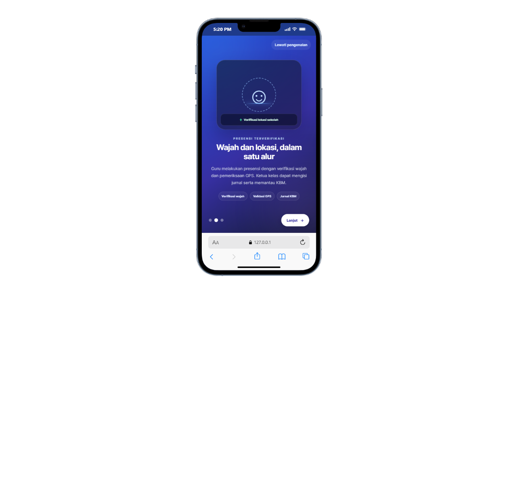
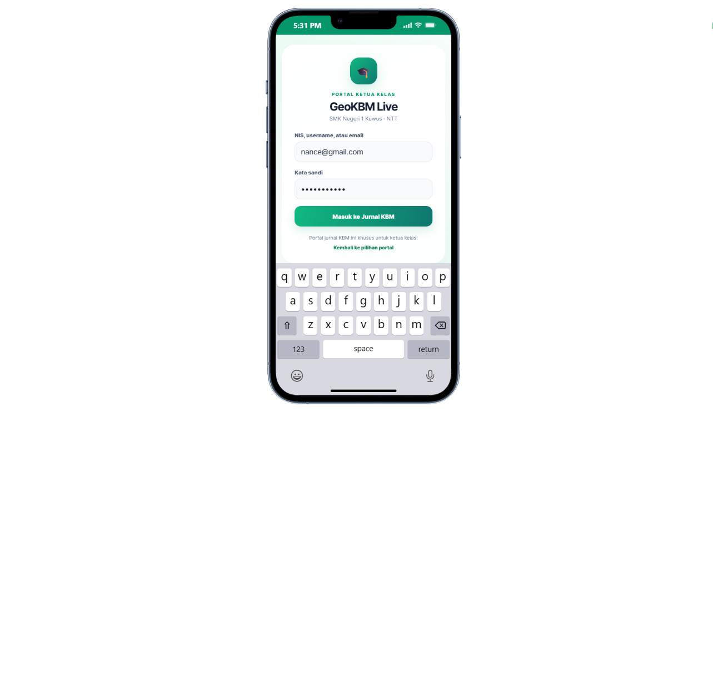
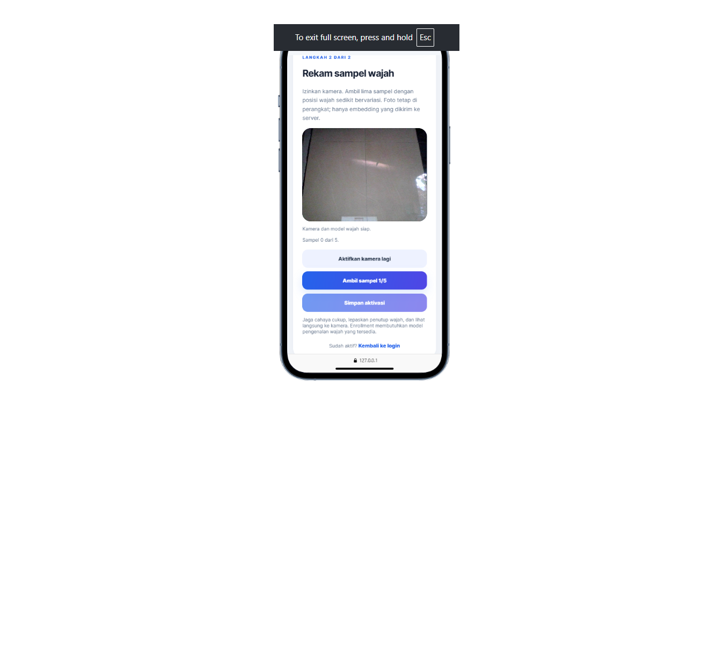
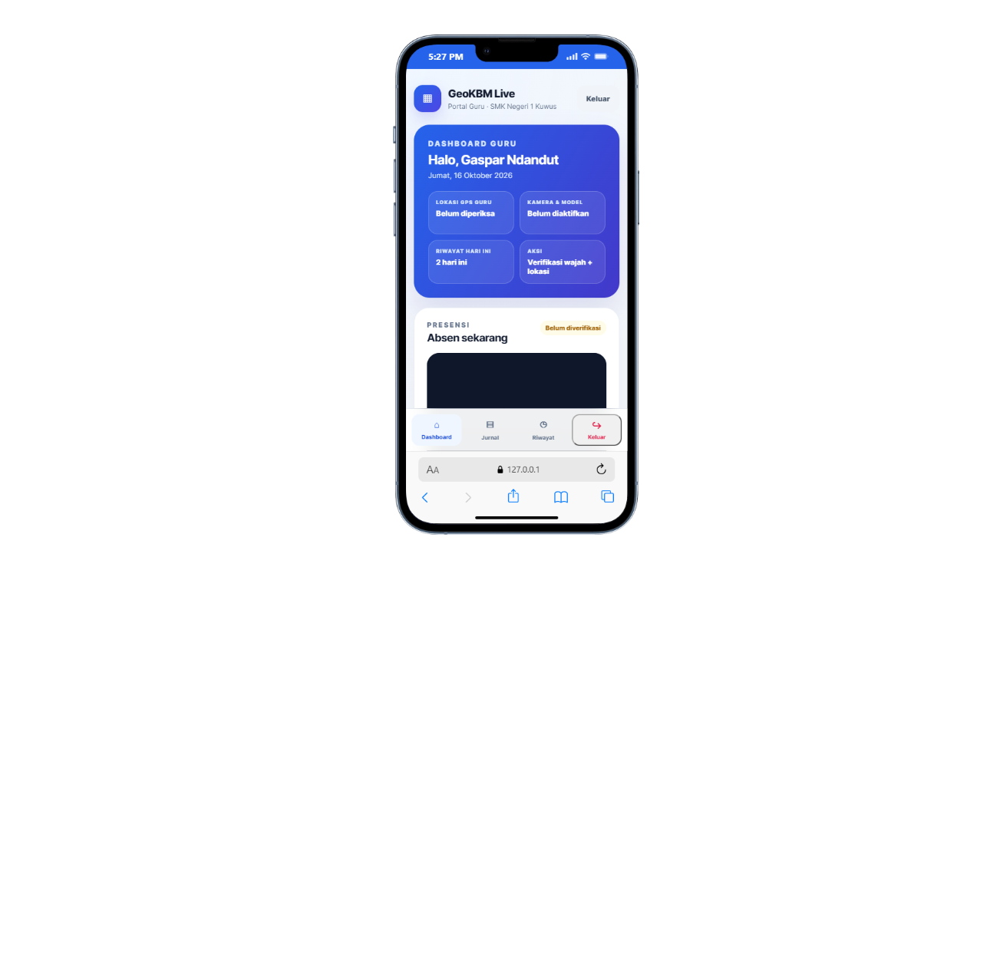
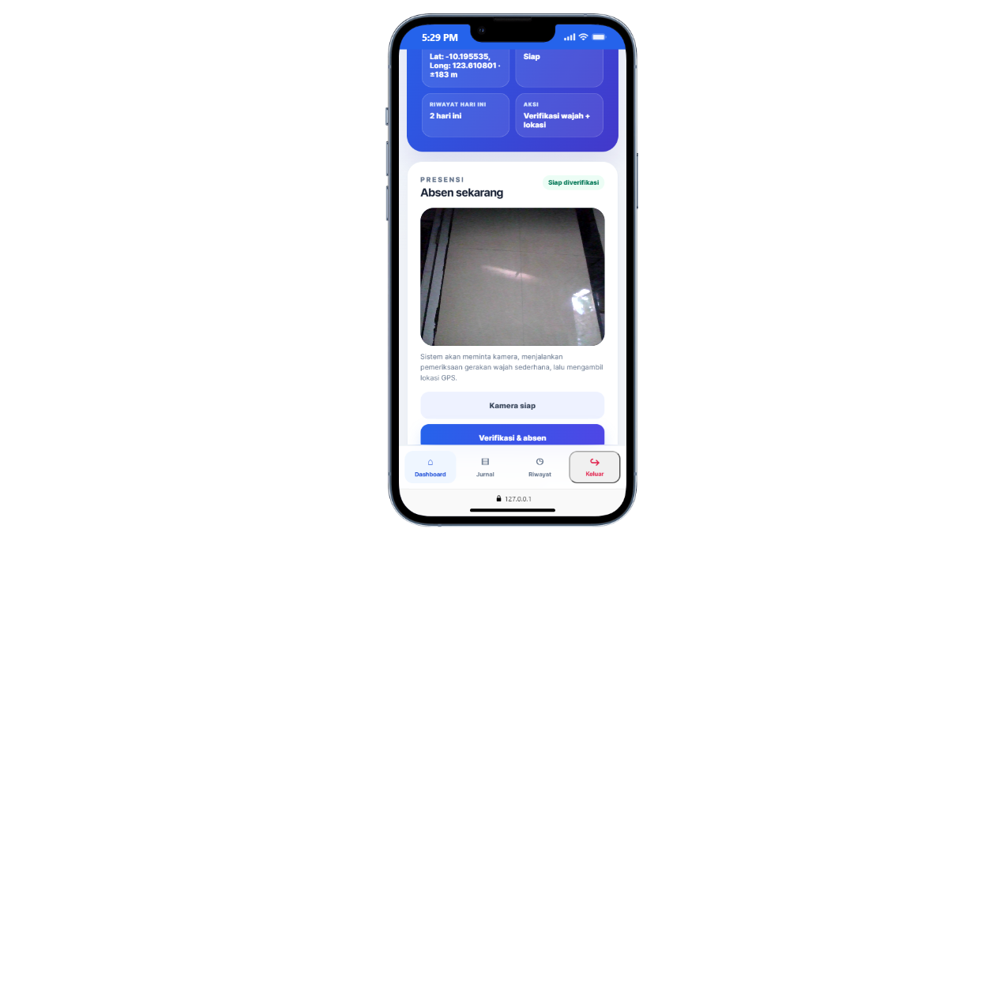
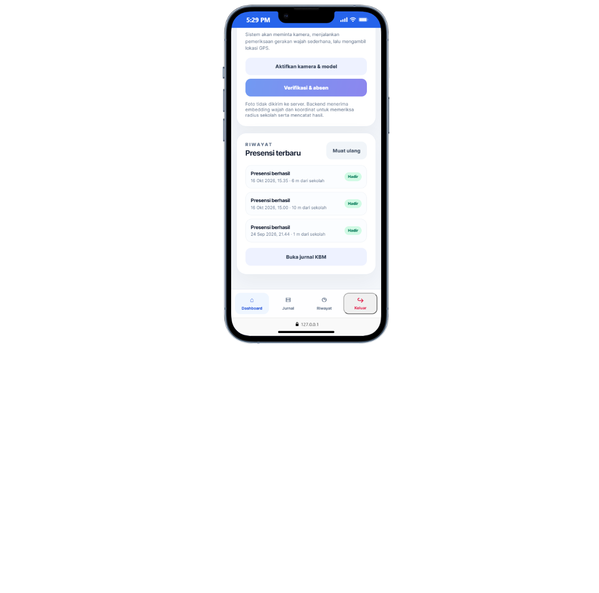
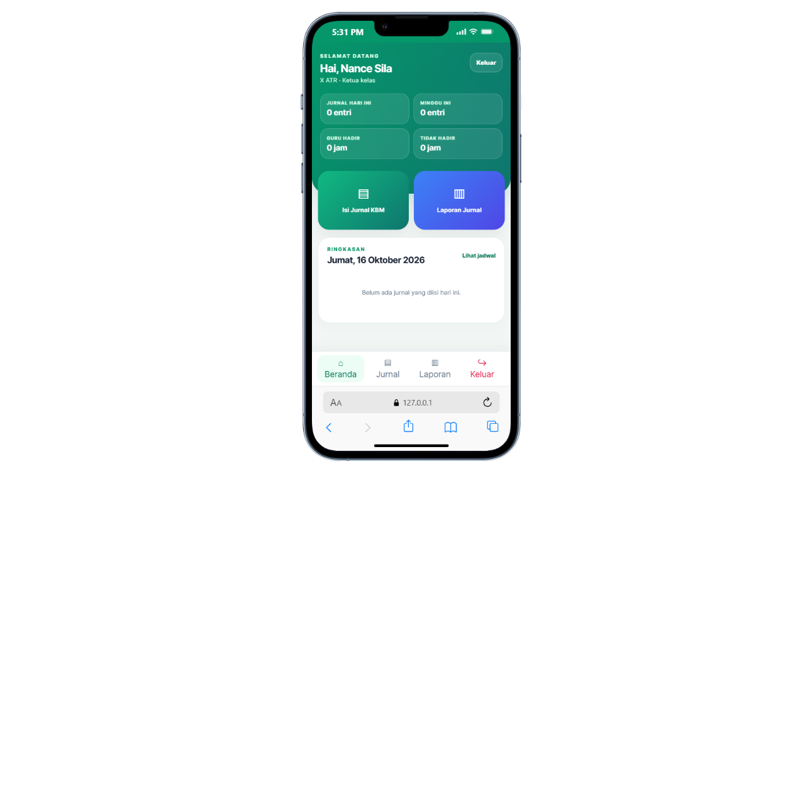
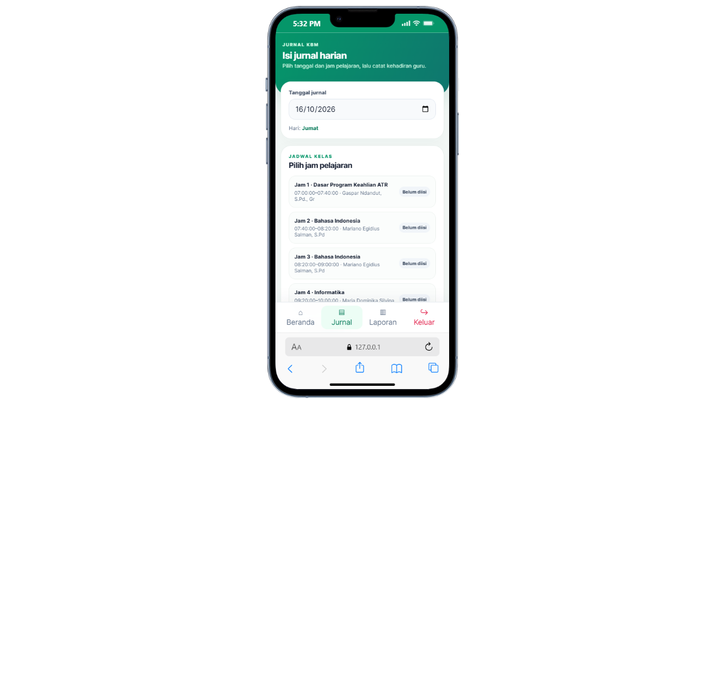
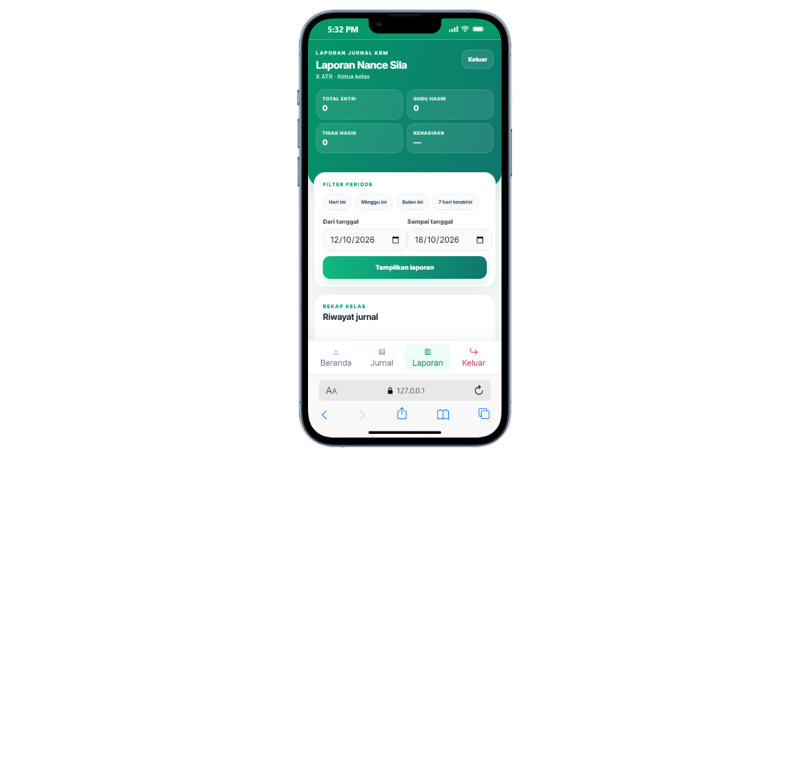
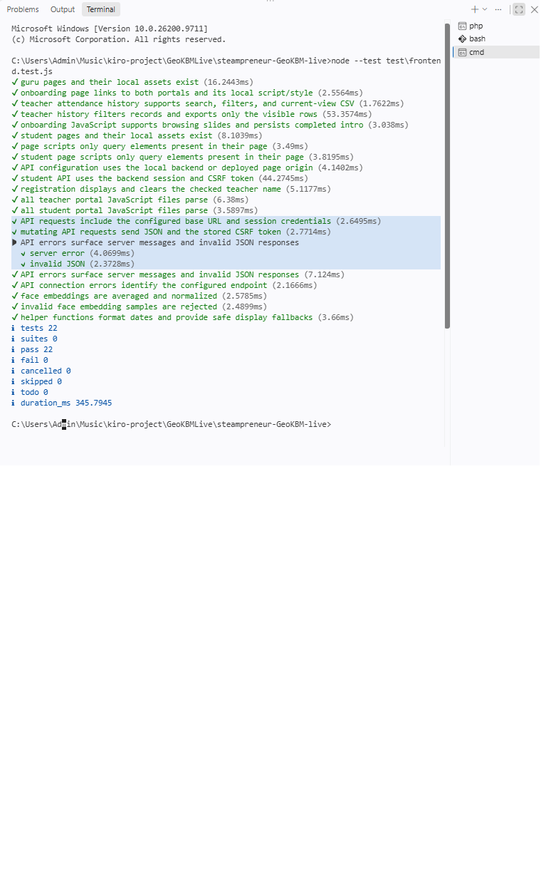

# GeoKBM Live

GeoKBM Live adalah aplikasi web untuk mendukung pemantauan kegiatan belajar mengajar SMK Negeri 1 Kuwus. Guru dapat melakukan presensi dengan verifikasi wajah dan GPS, kemudian mengisi jurnal mengajar. Ketua kelas dapat melihat jadwal, mencatat kehadiran guru, dan melihat rekap jurnal kelas.

Repository ini berisi frontend HTML/CSS/JavaScript dan backend PHP dengan MySQL/MariaDB. Frontend tidak memakai bundler atau langkah `npm install`.

## Alur Pengguna

1. Buka halaman onboarding, lalu pilih portal Guru atau Siswa.
2. Guru masuk menggunakan NIP dan kata sandi. Jika akun belum diaktifkan, guru mengecek NIP terdaftar, membuat kata sandi, dan mendaftarkan sampel wajah.
3. Guru menyiapkan kamera dan GPS, melakukan verifikasi wajah/liveness, lalu mengirim koordinat perangkat untuk divalidasi oleh backend.
4. Jika wajah valid dan lokasi berada dalam radius yang diizinkan dari titik sekolah, presensi disimpan dan dapat dilihat di riwayat.
5. Guru mengisi materi/catatan jurnal. Ketua kelas masuk menggunakan NIS, username, atau email, memilih jadwal kelas, lalu mengisi status kehadiran guru dan catatan kelas.
6. Ketua kelas melihat ringkasan jurnal dan laporan berdasarkan rentang tanggal.

## Fitur

- Onboarding responsif dengan pilihan portal guru atau siswa.
- Portal guru: login, aktivasi akun, pendaftaran wajah, presensi wajah + GPS, jurnal KBM, serta riwayat presensi dengan pencarian, filter, dan unduh CSV untuk baris yang sedang tampil (maksimal 100 catatan terbaru dari API).
- Portal ketua kelas: login, beranda, jadwal, pengisian status/catatan jurnal, dan laporan.
- API backend untuk guru, siswa/ketua kelas, admin, dan monitor. Frontend admin dan monitor tidak termasuk dalam `src/frontend` saat ini.
- Sesi backend memakai cookie `HttpOnly`; operasi yang mengubah data dilindungi token CSRF.
- Endpoint siswa menggunakan kelas dari sesi login. Browser tidak menentukan kelas yang boleh diakses.
- Backend membandingkan koordinat GPS perangkat guru dengan titik dari `konfigurasi_sekolah`. Radius efektif presensi tidak melebihi 50 meter; radius konfigurasi yang lebih kecil tetap berlaku.

## Prasyarat

- PHP 8.1 atau lebih baru dengan ekstensi `pdo_mysql`.
- Ekstensi PHP `mbstring` untuk validasi catatan jurnal siswa.
- MySQL 8+ atau MariaDB 10.4+.
- Node.js untuk menjalankan tes frontend menggunakan `node --test`.
- Browser modern. Kamera dan GPS memerlukan HTTPS, kecuali pada `localhost`.
- Koneksi internet saat pertama kali memuat library `face-api.js` dari jsDelivr. Model wajah lokal tersedia di `src/frontend/guru/models/`.

Tidak ada `package.json`, jadi `npm install` tidak diperlukan.

## Menyiapkan Database Uji

> Buat database **khusus pengembangan/pengujian**. Jangan gunakan database produksi dan jangan mengimpor dump `src/backend/db/sekolah_absensi.sql`, karena dump tersebut dapat berisi data pribadi dan biometrik.

1. Di MySQL Workbench atau tool administrasi database, buat database kosong bernama `geokbm_test` dan user MySQL khusus dengan hak akses hanya ke database tersebut.
2. Pilih database `geokbm_test`, lalu jalankan file `src/backend/db/schema.sql` melalui **File → Open SQL Script** dan tombol **Execute**. Schema ini membuat struktur tabel, bukan akun atau data contoh.
3. Tambahkan data uji sintetis melalui tool database, setidaknya:
   - konfigurasi sekolah dengan latitude, longitude, dan radius;
   - data guru serta embedding wajah uji yang valid untuk pengujian presensi;
   - data akun dan role untuk admin/ketua kelas sesuai relasi schema;
   - kelas, jadwal, jam pelajaran, dan mata pelajaran untuk pengujian jurnal.
4. Jangan menyalin NIP, NIS, nama, password, hash, koordinat, atau embedding dari dump sumber ke lingkungan uji.

Backend tidak membuat akun admin otomatis dan repository tidak menyediakan kredensial contoh. Siapkan akun uji secara lokal melalui proses tepercaya sesuai schema. Jangan menaruh password uji pada README atau commit.

## Menjalankan Secara Lokal di Windows

Gunakan dua terminal PowerShell terpisah. Pastikan MySQL/MariaDB berjalan dan database uji sudah disiapkan.

### 0. Ambil repository

```powershell
git clone https://github.com/Farrel-adinata/steampreneur-GeoKBM-live.git
Set-Location steampreneur-GeoKBM-live
```

### 1. Jalankan backend

Di terminal pertama, dari root repository:

```powershell
Set-Location src\backend
$env:DB_HOST = '127.0.0.1'
$env:DB_NAME = 'geokbm_test'
$env:DB_USER = 'geokbm_local'
$env:DB_PASS = '<PASSWORD_DATABASE_UJI>'
$env:APP_ORIGIN = 'http://127.0.0.1:5500'
$env:APP_TIMEZONE = 'Asia/Makassar'
$env:APP_DEBUG = '0'
php -S 127.0.0.1:8000 -t public router.php
```

Ganti placeholder dengan kredensial khusus database uji. Environment PHP di atas berlaku untuk proses server yang dijalankan dari terminal tersebut; jangan menaruhnya di frontend atau commit nilainya.

### 2. Sajikan frontend

Di terminal PowerShell kedua, dari root repository:

```powershell
php -S 127.0.0.1:5500 -t src\frontend
```

Buka **http://127.0.0.1:5500/**. Halaman awal adalah onboarding. Gunakan hostname `127.0.0.1` secara konsisten pada frontend dan API agar cookie sesi bekerja. Jika memakai port atau origin frontend berbeda, ubah `APP_ORIGIN` pada terminal backend agar sama persis dengan origin frontend, lalu mulai ulang server backend.

Untuk pemeriksaan cepat koneksi API, buka:

```text
http://127.0.0.1:8000/api/auth/csrf
```

Endpoint seharusnya mengembalikan JSON yang berisi token CSRF. Respons ini tidak membuktikan bahwa akun login atau seluruh alur database telah berfungsi.

### API pada deployment

Pada `localhost`/`127.0.0.1`, frontend menggunakan backend port `8000`. Di luar localhost, default API frontend adalah origin halaman. Jika API ditempatkan pada host berbeda, tetapkan `window.GEOKBM_ENV.API_BASE` sebelum `js/config.js` dijalankan pada halaman terkait. Backend harus dikonfigurasi dengan `APP_ORIGIN` yang cocok dengan origin frontend. Gunakan HTTPS di luar pengembangan lokal.

## Akun dan Data Contoh

Repository tidak menyediakan akun demo dan tidak menyertakan password untuk guru, ketua kelas, admin, atau monitor. Buat akun dan jadwal uji sintetis pada database lokal. Untuk login portal:

- Guru: NIP dan kata sandi yang telah disiapkan/diaktifkan.
- Siswa: NIS, username, atau email beserta kata sandi akun **ketua kelas**.
- Admin/monitor: akun dan role harus disiapkan sesuai schema; antarmuka portalnya tidak termasuk frontend yang tersedia di `src/frontend`.

## Menjalankan Pengujian

Jalankan dari root repository:

```powershell
node --test test\frontend.test.js
php test\run.php
php -l src\backend\src\auth.php
php -l src\backend\public\index.php
git diff --check
```

Hasil pengujian terakhir yang tercatat: tes frontend lulus (22 tes termasuk subtes), pemeriksaan backend lulus (33 pemeriksaan), dan dua file PHP lolos pemeriksaan sintaks. Angka ini merujuk pada validasi terakhir yang didokumentasikan dan bukan jaminan semua perubahan berikutnya telah diuji.

Tes otomatis saat ini memeriksa struktur/aset halaman, beberapa alur frontend dan API, sintaks JavaScript, serta helper backend seperti jarak, embedding, status jurnal, tanggal, dan schema. Tes tersebut **tidak** menggantikan pengujian end-to-end dengan database uji, akun uji, kamera, GPS, atau ponsel nyata. Skenario integrasi dicatat pada `docs/04-kasus-uji.md`.

## Pemecahan Masalah

| Gejala | Penyebab yang mungkin | Yang perlu diperiksa |
|---|---|---|
| Pesan tidak dapat terhubung ke API | Backend tidak berjalan atau `API_BASE` mengarah ke host/port salah. | Pastikan server PHP berjalan pada port 8000; akses `/api/auth/csrf`; periksa konfigurasi API frontend. |
| Error CORS atau “Origin tidak diizinkan” | Origin halaman frontend tidak sama dengan `APP_ORIGIN`. | Samakan skema, hostname, dan port, misalnya `http://127.0.0.1:5500`; mulai ulang backend sesudah mengubah environment. |
| Error koneksi database | MySQL mati, nama database/user/password keliru, atau schema belum diimpor. | Periksa `DB_HOST`, `DB_NAME`, `DB_USER`, `DB_PASS`, layanan MySQL, dan database uji. |
| Kamera atau GPS tidak tersedia | Izin browser ditolak, perangkat tidak memiliki sensor yang tersedia, atau halaman tidak berada pada konteks aman. | Izinkan kamera/lokasi; gunakan HTTPS atau `localhost`; muat ulang halaman. |
| Akun siswa ditolak | Akun tidak memiliki role ketua kelas atau belum aktif. | Pastikan relasi siswa-kelas, status akun, serta role/flag ketua kelas benar pada database uji. |
| Presensi ditolak karena lokasi | GPS perangkat di luar radius efektif atau titik sekolah belum valid. | Pastikan koordinat `konfigurasi_sekolah` benar dan tinjau jarak serta batas yang tertulis pada pesan. Batas tidak dapat melebihi 50 meter. |
| Port 5500 atau 8000 sudah dipakai | Proses lain sedang mendengarkan pada port tersebut. | Hentikan server pengembangan yang lama atau pilih port frontend lain dan sesuaikan `APP_ORIGIN`. Backend default frontend lokal mengarah ke port 8000. |

## Tangkapan Layar

Screenshot alur aplikasi tersedia di `docs/bukti/`.

### Onboarding dan login

| Alur | Tangkapan layar |
|---|---|
| Onboarding — pengenalan |  |
| Onboarding — fitur |  |
| Onboarding — pilih portal |  |
| Login guru |  |
| Login siswa/ketua kelas |  |

### Portal guru

| Alur | Tangkapan layar |
|---|---|
| Cek NIP saat aktivasi |  |
| Pendaftaran wajah |  |
| Dashboard — bagian 1 |  |
| Dashboard — bagian 2 |  |
| Dashboard — bagian 3 |  |
| Jurnal KBM guru |  |
| Riwayat presensi guru — pencarian dan filter |  |

### Portal siswa/ketua kelas

| Alur | Tangkapan layar |
|---|---|
| Beranda siswa |  |
| Jurnal KBM siswa |  |
| Laporan jurnal KBM |  |

Screenshot merupakan dokumentasi tampilan alur; screenshot saja tidak membuktikan keberhasilan integrasi API atau pengujian end-to-end. Jangan menyertakan bukti yang membocorkan data pribadi, token, kata sandi, atau embedding wajah.

### Bukti pengujian frontend



## Struktur Repository

| Lokasi | Isi |
|---|---|
| `src/frontend/index.html` | Entry point onboarding dan pilihan portal. |
| `src/frontend/guru/` | Halaman login, registrasi/aktivasi, dashboard, jurnal, CSS, JavaScript, dan model wajah lokal guru. |
| `src/frontend/siswa/` | Halaman login, home, jurnal, laporan, CSS, dan JavaScript portal ketua kelas. |
| `src/backend/public/` | Entry point HTTP API. |
| `src/backend/src/` | Handler autentikasi, guru, siswa, admin, monitor, konfigurasi, database, HTTP, dan validator. |
| `src/backend/db/schema.sql` | Struktur database untuk instalasi uji baru. |
| `src/backend/db/migrations/` | Migrasi legacy; cek README backend sebelum menjalankan. |
| `src/backend/db/sekolah_absensi.sql` | Dump sumber; **jangan gunakan untuk development/testing** karena dapat memuat data sensitif. |
| `test/` | Tes frontend Node.js dan pemeriksaan backend PHP. |
| `docs/` | Spesifikasi, rencana, log prompt, kasus uji, review, refleksi, dan penjelasan kode. |

## Demo

Belum ada URL demo yang dikonfirmasi dalam README ini. Jalankan aplikasi secara lokal mengikuti petunjuk di atas.

## Sumber, Library, dan Lisensi

| Komponen | Penggunaan | Sumber/lisensi |
|---|---|---|
| PHP, PDO MySQL, MySQL/MariaDB | Backend API dan penyimpanan data | Teknologi runtime; gunakan versi dan lisensi sesuai distribusi yang dipasang. |
| HTML, CSS, JavaScript | Frontend portal dan onboarding | Kode aplikasi pada repository ini. |
| `face-api.js` 0.22.2 | Deteksi wajah dan embedding di browser guru, dimuat dari jsDelivr | Paket pihak ketiga; periksa lisensi paket upstream dan persyaratan distribusi sebelum deployment. |
| Model wajah di `src/frontend/guru/models/` | Model lokal yang digunakan alur face-api.js | Asal dan lisensi setiap file model perlu diverifikasi dari sumber distribusinya sebelum penggunaan publik/produksi. |
| Model ONNX di `src/frontend/guru/models-arcface/` | Berkas referensi model ArcFace/SCRFD | Lihat README pada folder tersebut dan verifikasi lisensi/ketentuan penggunaan model sebelum mendistribusikan atau mengaktifkan inferensi. |

Tidak menganggap library, font, ikon, atau model eksternal sebagai milik tim. Tim perlu memeriksa dan mencatat lisensi upstream yang tepat sebelum rilis publik.

## Tim


| Nama | Peran |
|---|---|
| Ananiasti A. Mirta | Anggota tim GeoKBM Live (Frontend Developer) |
| Nevriana Kartika | Anggota tim GeoKBM Live (Backend Developer) |
| Farrel Adinata Garsi | Anggota tim GeoKBM Live (Database Developer) |
